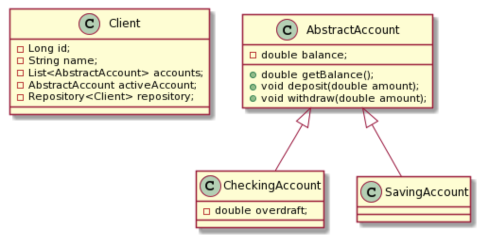
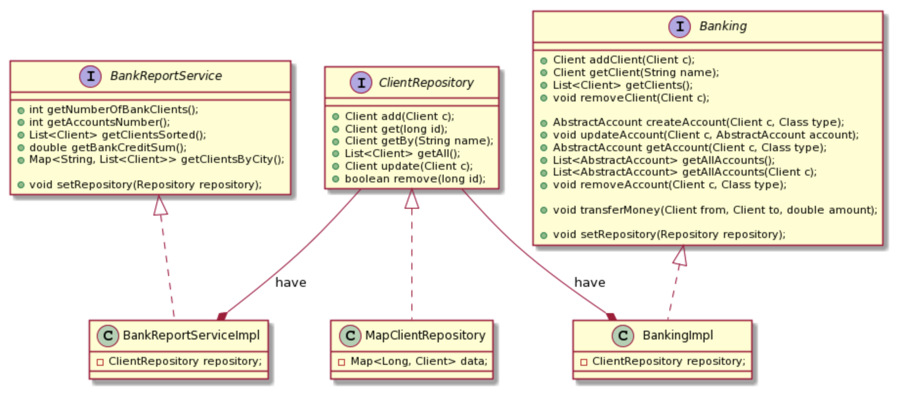

# Study the Bank Application

The idea is very simple. The bank has clients and every `Client` can open 2 accounts `SavingAccount` and `CheckingAccount` with overdraft.

## Domain objects



Here there are two main classes:

`AbstractAccount` that represents a bank account.

`Client` that represents a bank client and also contains logic to work with an active account, e.g. deposit, withdraw, and return current balance.

## Services



The `Banking` interface serves as a facade to implement all banking operations: working with clients, accounts, global money transfers, etc.

As well, it has a link to `MapClientRepository` (represented with `ClientRepository` interface).

`BankReportService` contains everything related to reports.

# Exercise 1

### Task 1: Set up banking

Set up **Spring** and add all services to application context. Services `Banking` and `ClientRepository` should be created and configured via Spring. Banking operations should work as before.

1. Open project **labs/ex1-t1-bank-app**;

2. Open `application-context.xml` from resources folder;

3. Create `ClassPathXmlApplicationContext` using

`application-context.xml` as input in `BankApplication` class;

4. Set up `MapClientRepository` and `BankingImpl` beans using autowire by type for banking to find storage dependency;

5. Modify `initialize` method to get `ApplicationContext` instead of `ClientRepository`:

```java
public static Banking initialize(ApplicationContext context) {...}
```

6. Fix compilation error. Replace `BankingImpl` object initialization with the code below. In this case you will have an object with already injected repository:

```java
Banking banking = (Banking) context.getBean("banking");
```

7. Make sure methods `workWithExistingClients(Banking)` and `bankingServiceDemo(Banking)` work properly;

> [!NOTE]
> Note: All tests from `BankApplicationTask1Tests` should pass.

### Task 2: Configure Reporting

`BankReportService` should be created and configured with Spring. Logic should not be updated.

1. Add `BankReportServiceImpl` to `application-context.xml`;

2. Modify the **bankReportsDemo** method to get `ApplicationContext` instead of **ClientRepository**;

```java
public static void
	bankReportsDemo(ApplicationContext context) {...}
```

3. Fix compilation error. Replace `BankReportServiceImpl` object initialization with code bellow. In this case you will have an object with already injected repository.

```java
BankReportService reportService =
	(BankReportService) context.getBean("bankReport");
```

4. Make sure methods `bankReportsDemo(ApplicationContext)` work properly;

> [!NOTE]
> Note: All tests from `BankApplicationTask2Tests` should pass.

### Task 3: Configure Clients

Here we are configuring and adding two clients inside the `BankApplication` class.

```java
Banking initialize(ApplicationContext context)
```

We need these clients and accounts to demo the application after start. You should move these clients to a separate Spring configuration file. Then get these clients from **Spring** context and add to `Banking`.

1. Create and add `test-clients.xml` to resources folder. (It is better to copy `application-context.xml`, rename it, and remove all the beans.);

2. Add this file to `ClassPathXmlApplicationContext;`

3. Now we should import `application-context.xml` to `test-clients.xml` because we will need some beans from this file;

Configure two beans:

4. Bean `savingAccount1` with `initialBalance` value `1000;`

5. Bean `checkingAccount1` with `overdraft` value `1000;`

6. Configure bean `client1` with `name` *Jonny Bravo*, also set `gender`, `repository` and `accounts` properties;

Note that we already have `repository` configured in `application-context.xml`

Also you should add setter method for `accounts` to the `Client` class

7. Replace `client_1` with bean `client1` inside `BankApplication#initialize(ApplicationContextcontext)` method;

8. Check everything should work as before;

> [!NOTE]
> Note: All tests from `BankApplicationTask1Tests` and `BankApplicationTask2Tests` should pass.

9. Repeat points 4-7 for `client_2` and check the results.

Note that `client_2` has only one checking account with overdraft of 1500 and name `AdamBudzinski`.

10. Check everything should work as before;

> [!NOTE]
> Note: All tests from `BankApplicationTask1Tests` and `BankApplicationTask2Tests` should pass.

Now we have only one issue. We should put all test data like client names, cities, etc. to .xml file.

11. Create `clients.properties` file and fill it with test data like this:

`client1`=`Jonny Bravoclient2`=`AdamBudzinskiclient3`=`Anna Smith`

Now when we have this file we can set up Spring to read it and replace all values with needed names. Also you can put their cities, account balances, etc.

12. Configure a new bean with `PropertyPlaceholderConfigurer` class and set `clients.properties` to location property;

```xml
<bean class="org.springframework.context.support.PropertySourcesPlaceholderConfigurer">
    <property name="location" value="clients.properties"/>
</bean>
```

13. Replace all values with placeholders from `clients.properties.` Use this syntax `${key_from_file};`

14. Import `application-context.xml` to `test-clients.xml`

```xml
<import resource="application-context.xml"/>
```

15. Check your work. All tests should pass.

# Exercise 2

### Task 1: Annotation Based Dependencies

In this task we move all dependency configuration from `application-context.xml` to annotations.

1. To enable annotation processing, add to your `application-context.xml` (next line on top)

```xml
<context:annotation-config />
```

2. Remove `autowire` attribute from the `banking` bean configuration;

3. Mark `repository` field of `BankingImpl` class with `@Autowired` annotation;

4. Check your work. All tests from `BankApplicationTask1Tests` should pass.

5. Remove `repository` property from the `bankReport` bean configuration;

6. Mark `storage` field of `BankReportServiceImpl` class with `@Autowired` annotation;

7. Check your work. All tests should pass.

# Exercise 3

### Task 1: Java Based Configuration

In this task we move configuration from `application-context.xml` to annotations and remove this file from the project. After refactoring we will have Java Based Spring configuration with no xml.

1.  Add `@Service` annotations to `MapClientRepository`, `BankingImpl`, `BankReportServiceImpl`;

2.  Add `@Configuration` and `@ComponentScan("com.luxoft.bankapp")` annotations to `BankApplication` class;

3. Open `BankApplication` class and replace `ClassPathXmlApplicationContext` class with

`AnnotationConfigApplicationContext`;

```java
ApplicationContext context = new 		 
	AnnotationConfigApplicationContext(BankApplication.class);
```

5. Remove `application-context.xml` file;

6. Check your work. All tests from `BankApplicationTask1Tests`, `BankApplicationTask2Tests`, should pass.

### Task 2: Java Based Configuration (for test clients)

In this task we move configuration from `test-clients.xml` to `BankApplication` class and remove this file from the project. After refactoring we will have Java Based Spring configuration with no xml at all.

1. Open `BankApplication` class;

2.  Add `@PropertySource("classpath:clients.properties")` annotation;

3. Add property:

```java
@Autowired
private ApplicationContext applicationContext;
```

4. Add property:

```java
@Autowired
private Environment environment;
```

5. Configure the `CheckingAccount` bean with next code:

```java
@Bean(name = "checkingAccount2")
public CheckingAccount getDemoCheckingAccount2()
{
    return new CheckingAccount(1500);
}
```

6. Configure `Client` bean with next code:

```java
@Bean(name = "client2")
public Client getDemoClient2()
{
    String name = environment.getProperty("client2");

    Client client = new Client(name, Gender.MALE);
    client.setCity("Kiev");

    AbstractAccount checking = (CheckingAccount)
		applicationContext.getBean("checkingAccount2");

    client.addAccount(checking);

    return client;
}
```

6. Configure the `client1` bean in the same way as we did for `client2`;

> [!NOTE]
> *Note: `client1` should have 2 accounts! `checkingAccount1` and `savingAccount1` as we have before in xml.

7. Now you should have 5 configured beans `client1`, `client2`, `checkingAccount1`, `checkingAccount2`, and `savingAccount1`;

8. Open the `BankApplication#initialize` method and replace clients creation with next code:

```java
Client client_1 = (Client) context.getBean("client1");
Client client_2 = (Client) context.getBean("client2");
```

9. Remove `test-clients.xml` file;

10. Open the `BankApplication#bankReportsDemo` method and replace code to get `reportService` with next code:

```java
BankReportService reportService =
		context.getBean(BankReportService.class);
```

11. Open the `BankApplication#bankingServiceDemo` method and replace code to get `banking` with next code:

```java
Banking banking = context.getBean(Banking.class);
```

Also update method declaration to:

```java
public static void
	bankingServiceDemo(ApplicationContext context) {...}
```

12. Do step 11 for the `BankApplication#workWithExistingClients`

method.

13. Check your work. All tests should pass.

# Exercise 4

### Task 1: Switch to Spring Boot

In this task we should open https://start.spring.io/ - select all dependencies and generate a new application. This is done, so go to the application, open the project and study.

### Task 2: Profiles Configuration

In this task we configure dev and prod profiles using application properties and move bank initialization logic from the `BankApplication` class to a separate service.

1. Rename `application.properties` file to `application.yml`;

2. Configure profiles `dev` and `prod` with different `debug` options;

Your configuration should look like this:

```yaml
spring.profiles.active: dev
---
spring:
  profiles: dev
  debug: true
---
spring:
  profiles: prod
  debug: false
```

And now we should configure `DemoBankInitializationService.`

3. Mark `DemoBankInitializationService` with annotation `@Profile("dev")`;

4. Add the `BankFeedServiceImpl` field with `@Autowired` annotation;

5. Now we need to make sure that demo clients created after application will start, so we mark method `createClientsForDemo` with `@PostConstruct` annotation;

6. Implement `createClientsForDemo` with the next code:

```java
feedService.loadFeed(new File("demo.feed"));
```

7. Remove everything from the `BankApplication` class; the main method should contain only application run code:

```java
SpringApplication.run(BankApplication.class, args);
```

8. Check your work. All tests from `BankApplicationTests1` should pass.

### Task 3: Custom Feed File Name

In this task we configure `DemoBankInitializationService` to use a custom feed file name (if it exists in configuration).

1. Open `DemoBankInitializationService` and add `fileName` field with `@Value` annotation:

```java
@Value("${feed.filename}")
private String fileName;
```

2. Update `createClientsForDemo` method to use this field (if not null):

```java
@Override
@PostConstruct
public void createClientsForDemo()
{
    if (fileName == null)
    {
        fileName = DEMO_FEED_FILE_NAME;
    }

    feedService.loadFeed(new File(fileName));
}
```

3. Add `feed.filename: demo.feed` property to `application.yml`;

4. Check your work. All tests from `BankApplicationTests2` should pass.

# Exercise 5

### Task 1: Banking Operations

In this task we will add a service to work with client accounts: deposit, withdraw, and check balance.

1. Open `ex5-task1-bankapp` project;

2. Look to the `com.luxoft.bankapp.service.operations` package. You will find `BankingOperationsServiceImpl` service;

3. `BankingOperationsServiceImpl` class that implements `BankingOperationsService` and mark it with `@Service` annotation.

4. All methods already implemented. Check your work with `BankApplicationTests3`. All tests should pass.

### Task 2: Audit Service

In this task we will add `AuditService` that logs banking operations. Then we'll add `AuditAspect` to monitor every call from `BankingOperationsService` and call the appropriate method from `AuditService`.

1. Add `spring-boot-starter-aop` to `pom.xml` dependency list:

```xml
<dependency>
	<groupId>org.springframework.boot</groupId>
	<artifactId>spring-boot-starter-aop</artifactId>
</dependency>
```

2. Create the `com.luxoft.bankapp.service.audit` package;

3. Create an empty `Audit` interface;

4. Create enum `WithdrawState` with `TRYING`, `SUCCESSFUL`, and `FAILED` values. We will log user actions before and after withdrawal with appropriate states;

Use the code below:

```java
public enum WithdrawState
{
    TRYING, SUCCESSFUL, FAILED
}
```

5. Now add next methods to `Audit` interface:

```java
public interface Audit
{
	void auditDeposit(long accountId, double amount);

	void auditWithdraw(long accountId, double amount, WithdrawState state);

	void auditBalance(long accountId);
}
```

6. Create `AuditService` class that implements `Audit` and mark it with `@Service` annotation;

It should contain the next code:

```java
@Service
public class AuditService implements Audit
{
   @Override
    public void auditDeposit(long accountId,
								 double amount)
    {
        System.out.println("ACCOUNT ID: "
			 + accountId + " DEPOSIT: " + amount);
    }

    @Override
    public void auditWithdraw(long accountId,
				double amount, WithdrawState state)
    {
        System.out.println("ACCOUNT ID: "
			 + accountId + " " + state
			 + " WITHDRAWAL: " + amount);
    }

    @Override
    public void auditBalance(long accountId)
    {
        System.out.println("ACCOUNT ID: "
			 + accountId + " BALANCE CHECK");
    }
}
```

Very good! Now only one step is left. We should create an aspect that connects these two services.

7. Create `AuditAspect` class and mark it with `@Configuration` and `@Aspect` annotations;

8. Add the `Audit` property to have an ability to log events:

```java
@Autowired
private Audit audit;
```

9. Then create pointcuts for operations. We should know when these methods are executing:

```java
@Pointcut("execution(* com.luxoft.bankapp.service.operations.*.deposit(..))")
public void anyDeposit() {}

@Pointcut("execution(* com.luxoft.bankapp.service.operations.*.withdraw(..))")
public void anyWithdraw() {}

@Pointcut("execution(* com.luxoft.bankapp.service.operations.*.getBalance(..))")
public void anyBalance() {}
```

10. Create method `getAccountId` which we will use to extract `accountId` from method arguments;

Use the code below:

```java
private long getAccountId(Object[] methodArgs)
{
    Account account;

    if (methodArgs[0] instanceof Client)
    {
        account = ((Client)  methodArgs[0])
						.getActiveAccount();
    }
    else
    {
        account = (Account) methodArgs[0];
    }

    return account.getId();
}
```

11. Create `@Before` advice for deposit operation and fire event (before the method is called);

Use the code below:

```java
@Before("anyDeposit()")
public void logDeposit(JoinPoint joinPoint)
{
    Object[] methodArgs = joinPoint.getArgs();

    audit.auditDeposit(getAccountId(methodArgs),
		(double) methodArgs[1]);

}
```

12. Check your work. Run the tests from `BankApplicationTests4 deposit*` which should all pass;

13. Create `@Before` advice for balance operation yourself and run the test again. Now the `getClientBalance` test should pass too.

Good! Only one more step:

14. Create `@Around` advice for withdraw operation and log user actions (before and after method call). First log will have a `TRYING` status and second will have `SUCCESSFUL` or `FAILED` accordingly.

Use the code below:

```java
@Around("anyWithdraw()")
public Object logWithdrawal(ProceedingJoinPoint thisJoinPoint) throws Throwable
{
	Object[] methodArgs = thisJoinPoint.getArgs();

	long accountId = getAccountId(methodArgs);

	audit.auditWithdraw(accountId,
		(double) methodArgs[1], WithdrawState.TRYING);

	Object result;

	try
	{
    		result = thisJoinPoint.proceed();

	    audit.auditWithdraw(accountId,
			(double) methodArgs[1],
			WithdrawState.SUCCESSFUL);
	}
	catch (Exception e)
	{
    		audit.auditWithdraw(accountId,
			(double) methodArgs[1],
			WithdrawState.FAILED);

	    throw e;
	}

	return result;
}
```

15. Check your work. Run the tests from `BankApplicationTests4` which should all pass.

### Task 3: Audit Service Events

Currently, our `AuditAspect` relies on `Audit` service to log all operations. This creates unnecessary dependency. In this task we will refactor `Audit` service and `AuditAspect` to use the Spring events mechanism (instead of direct method calls).

1. Create `com.luxoft.bankapp.service.audit.events` package;

2. Create abstract class `AccountEvent` that extends `ApplicationEvent` with the next code:

```java
public abstract class AccountEvent extends ApplicationEvent
{
    private long accountId;

    public AccountEvent(Object source, long accountId)
    {
        super(source);
        this.accountId = accountId;
    }

    public long getAccountId()
    {
        return accountId;
    }
}
```

3. Then create 3 event classes: `BalanceEvent`, `DepositEvent`, and `WithdrawEvent`. All these classes should extend `AccountEvent`:

`BalanceEvent` and `DepositEvent` events are pretty simple, just data;

`WithdrawEvent` event also will contain `State` with `TRYING`, `SUCCESSFUL`, and `FAILED` values. We will send two events (before withdrawal and after with appropriate states).

Use the code below:

```java
public class BalanceEvent extends AccountEvent
{
    public BalanceEvent(long accountId)
    {
        super("BALANCE CHECK", accountId);
    }
}

public class DepositEvent extends AccountEvent
{
    private double amount;

    public DepositEvent(long accountId, double amount)
    {
        super("DEPOSIT", accountId);
        this.amount = amount;
    }

    public double getAmount()
    {
        return amount;
    }
}

public class WithdrawEvent extends AccountEvent
{
    private double amount;
    private State state;

    public WithdrawEvent(long accountId, double amount)
    {
        super("WITHDRAWAL", accountId);
        this.amount = amount;
        this.state = State.TRYING;
    }

    public WithdrawEvent(long accountId, double amount, State state)
    {
        super("WITHDRAWAL", accountId);
        this.amount = amount;
        this.state = state;
    }

    public double getAmount()
    {
        return amount;
    }

    public State getState()
    {
        return state;
    }

    public enum State
    {
        TRYING, SUCCESSFUL, FAILED
    }
}
```

4. Once events are ready to use, replace all methods from `Audit` interface:

```java
public interface Audit
{
    void auditOperation(DepositEvent event);

    void auditOperation(WithdrawEvent event);

    void auditOperation(BalanceEvent event);
}
```

5. Update the `AuditService` class that implements `Audit` with the next code:

```java
@Service
public class AuditService implements Audit
{
    private List<AccountEvent> events;

    public AuditService()
    {
        this.events = new ArrayList<>(100);
    }

    @Override
    @EventListener
    public void auditOperation(DepositEvent event)
    {
        events.add(event);
        System.out.println("ACCOUNT ID: "
			 + event.getAccountId() + " "
			 + event.getSource() +
			 ": " + event.getAmount());
    }

    @Override
    @EventListener
    public void auditOperation(WithdrawEvent event)
    {
        events.add(event);
        System.out.println("ACCOUNT ID: "
			 + event.getAccountId() + " "
			 + event.getState() + " "
			 + event.getSource() + ": "
			 + event.getAmount());
    }

    @Override
    @EventListener
    public void auditOperation(BalanceEvent event)
    {
        events.add(event);
        System.out.println("ACCOUNT ID: "
			 + event.getAccountId() + " "
			 + event.getSource());
    }

    public List<AccountEvent> getEvents()
    {
        return new ArrayList<>(events);
    }
}
```

5. Remove `WithdrawState` which is not needed anymore, as now we have `State` as inner enum within `WithdrawEvent`. Now it's time to update `AuditAspect`;

6. Add `applicationContext` property to have an ability to publish events:

```java
@Autowired
private ApplicationContext applicationContext;
```

7. Remove the `audit` property from the class;

8. Open the `logDeposit` method and replace `audit` call with the next code:

```java
applicationContext.publishEvent(
        new DepositEvent(getAccountId(methodArgs),
							(double) methodArgs[1]));
```

9. Open the `logBalance` method and replace `audit` call with the next code:

```java
applicationContext.publishEvent(
        new BalanceEvent(getAccountId(methodArgs)));
```

10. Open the `logWithdrawal` method and replace `audit` calls with the next code:

a. before `thisJoinPoint.proceed()`

```java
applicationContext.publishEvent(
        new WithdrawEvent(getAccountId(methodArgs),
							 (double) methodArgs[1]));
```

b. after successful result

```java
applicationContext.publishEvent(
        new WithdrawEvent(getAccountId(methodArgs),
	                (double) methodArgs[1],
					WithdrawEvent.State.SUCCESSFUL));
```

c. after exception

```java
applicationContext.publishEvent(
        new WithdrawEvent(getAccountId(methodArgs),
	                (double) methodArgs[1],
					WithdrawEvent.State.FAILED));
```

11. Fix tests. Use the code below to replace all tests from `BankApplicationTests4`:

```java
import static org.junit.jupiter.api.Assertions.assertEquals;

import static org.junit.jupiter.api.Assertions.assertThrows;

@SpringBootTest(classes = BankApplication.class)
public class BankApplicationTests4
{
    @Autowired
    private Banking banking;

    @Autowired
    private BankingOperationsService
					bankingOperationsService;

    @Autowired
    private AuditService auditService;

    private Client client;

    @BeforeEach
    public void init()
    {
        client = banking.getClient("Jonny Bravo");
        client.setDefaultActiveAccountIfNotSet();
        client.getActiveAccount().setId(999);
    }

    @Test
    public void depositToClient1()
    {
        double amount = 100;

        int countOfEvents =
				auditService.getEvents().size();

        bankingOperationsService.deposit(client, amount);

        assertEquals( countOfEvents + 1,
				auditService.getEvents().size());
    }

    @Test
    public void depositToClient2()
    {
        Account account = client.getActiveAccount();
        double amount = 100;

        int countOfEvents =
			auditService.getEvents().size();

        bankingOperationsService
			.deposit(account, amount);

        assertEquals( countOfEvents + 1,
				auditService.getEvents().size());
    }

    @Test
    public void getClientBalance()
    {
        int countOfEvents =
			auditService.getEvents().size();

        bankingOperationsService.getBalance(client);

        assertEquals( countOfEvents + 1,
				auditService.getEvents().size());
    }

    @Test
    public void withdrawFromClient1()
    {
        double amount = 100;

        int countOfEvents =
			auditService.getEvents().size();

        bankingOperationsService
				.withdraw(client, amount);

        assertEquals( countOfEvents + 2,
				auditService.getEvents().size());
    }

    @Test
    public void withdrawFromClient2()
    {
        Account account = client.getActiveAccount();
        double amount = 100;

        int countOfEvents =
				auditService.getEvents().size();

        bankingOperationsService
				.withdraw(account, amount);

        assertEquals( countOfEvents + 2,
				auditService.getEvents().size());
    }

    @Test
    public void withdrawFromClient3()
    {
        Account account = client.getActiveAccount();
        double balance = account.getBalance();
        double overdraft = 0;

        if (account instanceof CheckingAccount)
        {
            overdraft =
			 ((CheckingAccount) account).getOverdraft();
        }

        double amount = balance + overdraft + 1000;

        int countOfEvents =
				auditService.getEvents().size();

        assertThrows(NotEnoughFundsException.class,
                () ->
					bankingOperationsService
						.withdraw(account, amount));

        assertEquals(auditService.getEvents().size(),
					countOfEvents + 2);
    }

}
```

12. Check your work. Run the tests from `BankApplicationTests4which` should all pass.

### Task 4: Filtering Audit Events

Currently, our `AuditService` logs every event (deposit, withdrawal, balance). We need an ability to limit it down and at the same time we don't want to change the code. So, in this task we will add a specific property that will help `AuditService` to make a final decision.

1. Open `application.yml` and add the next properties:

```yaml
audit.amount:
  deposit: 99
  withdrawal: 99
```

2. Go to the `com.luxoft.bankapp.service.audit` package and create class `EventConditionFilter` with the next code:

```java
@Component
public class EventConditionFilter
{
    @Value("${audit.amount.deposit}")
    public double depositLimit;

    @Value("${audit.amount.withdrawal}")
    public double withdrawalLimit;
}
```

Open AuditService and update our `@EventListener` annotations for `auditOperation(..)` methods for `deposit` and `withdrawal`. Note that we need to put `@` before the bean name to make it visible for SpEL.

Use the code below:

```java
@EventListener(condition = "#event.amount
		>= @eventConditionFilter.depositLimit")

@EventListener(condition = "#event.amount
		>= @eventConditionFilter.withdrawalLimit")
```

4. Check your work using tests from `BankApplicationTests4` now (all the tests should pass as before). But if you changed the `deposit` or `withdrawal` property to any value greater than `100,the` tests could fail because of our new event filtering.
